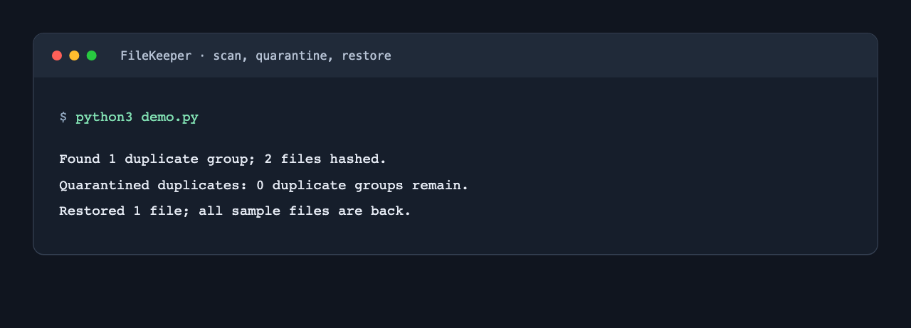

# FileKeeper

[](https://github.com/darshmahadevia/filekeeper/actions/workflows/tests.yml)

Find duplicate files, move extra copies to quarantine, and restore them when needed.

FileKeeper is a Python CLI with no runtime dependencies. It requires Python 3.11 or newer and supports macOS and Linux. Cleanup only changes files when you add `--apply`.



## Try it

```bash
git clone https://github.com/darshmahadevia/filekeeper.git
cd filekeeper
python3 demo.py
```

The demo finds a duplicate, quarantines it, and restores it using temporary files.

## Use it on a folder

Find duplicates and preview cleanup:

```bash
python3 -m filekeeper scan ./my-folder
python3 -m filekeeper clean ./my-folder
```

FileKeeper keeps the first path in each alphabetically sorted duplicate group. Check the preview, then apply cleanup:

```bash
python3 -m filekeeper clean ./my-folder --apply --verify-bytes
```

`--verify-bytes` adds a byte-for-byte comparison before moving files. Extra copies go into `.filekeeper-trash`. Quarantine preserves their contents, so it does not free disk space.

Cleanup prints a run directory. Replace `RUN_ID` with that directory's name:

```bash
python3 -m filekeeper restore ./my-folder/.filekeeper-trash/RUN_ID
```

If cleanup stops, use `resume` with the same run path to finish it, or `restore` to undo it. Use `status` to inspect progress. Once restoration starts, finish it with `restore`.

## Speed up repeat scans

Save hashes in a SQLite database outside the scanned folder:

```bash
python3 -m filekeeper scan ./my-folder --cache ./hashes.sqlite3
```

Later scans reuse hashes when file identity and metadata match. Cleanup still rechecks file contents. Add `--json` to `scan` or `clean` for machine-readable output.

## Measured results

Local measurements on an Apple M4, Python 3.12.12, and macOS, using five runs per mode:

- A 2 GiB duplicate-heavy scan after OS cache eviction took **3.388 s median** without a hash database and **0.223 s** with a populated one.
- Cleanup of 1,000 duplicates improved from **7.216 s to 1.173 s median** after removing repeated full-manifest writes.

The benchmark suite records 180 validated scan samples, including folders with 20,000 files and up to 4 GiB of content. These results describe one machine. See the [benchmark guide](benchmarks/README.md) for ranges, raw data, commands, and limits.

## Tests and design

```bash
python3 -m unittest discover -s tests -v
```

The 63 tests cover scanning, hash caching, byte verification, and recovery after forced process exits. GitHub Actions runs them on Python 3.11, 3.12, and 3.13.

FileKeeper filters by size before hashing candidates with SHA-256. Cleanup saves a recovery plan before moving files. Recovery checks current file locations and inode identity to finish interrupted moves.

Read the [design notes](DESIGN.md) for tradeoffs or the [architecture walkthrough](ARCHITECTURE.md) to follow the code.

## Limits

- Keep the folder unchanged while FileKeeper runs. Its lock cannot stop other applications from editing files.
- Cleanup requires a local filesystem with hard-link support. Renaming the root folder afterward prevents recovery.
- Recovery tests cover process exits, not power loss or hardware failure.
- Cached metadata can miss changes that the filesystem does not report. Scan without `--cache` when you need fresh reads.
- Matching hashes count as equal content by default. Use `--verify-bytes` for an extra comparison.
- Recovery plans contain original file paths. Treat them as private when the folder is private.
